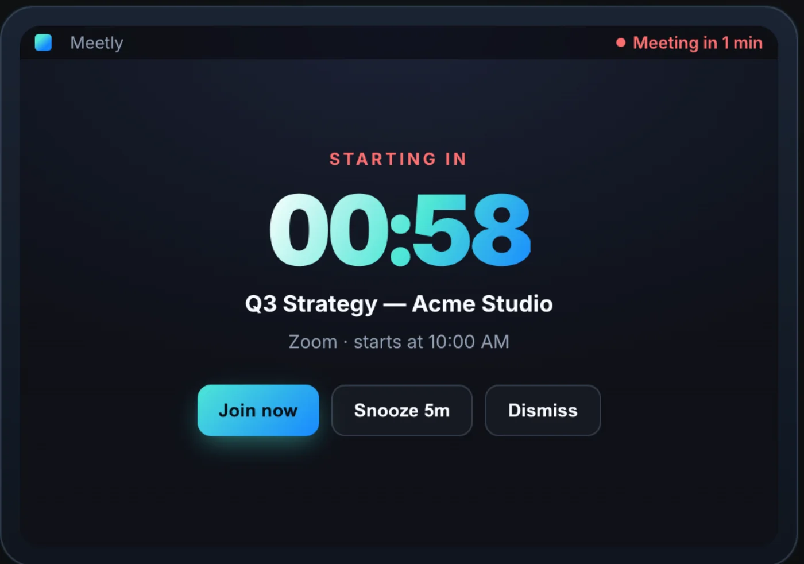
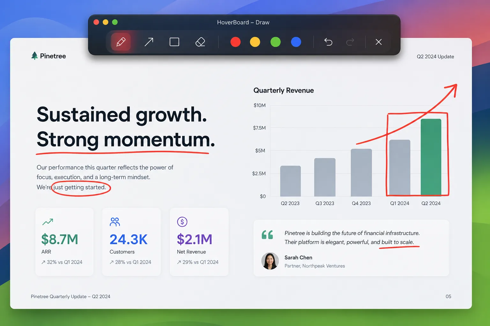

Black Friday is when subscription fatigue finally gets punished: this year, every **Pro app** in the codeonholiday store is **50% off** with code **BLACKFRIDAY** — one-time purchases, not subscriptions. The sale runs through **30 November 2026**, then list prices return.

If you are hunting **Black Friday Mac app deals**, **Black Friday software deals 2026**, or a cheap one-time license for a Mac tool you will actually keep using, this covers three native apps: [Meetly](/meetly/) for meeting reminders, [HoverBoard](/hoverboard/) for screen annotation and presenting, and [LocalMelody](/localmelody/) for private local AI music.

**Short answer:** use code **BLACKFRIDAY** at checkout (it fills in automatically when you click Buy Pro during the sale). Meetly Pro drops to **$4.99**, HoverBoard Pro to **$7.99**, LocalMelody Pro to **$4.99** — each a single lifetime payment.

## Black Friday 2026: the deals at a glance

| App | Regular price | Black Friday price (50% off) |
|---|---:|---:|
| [Meetly](/meetly/#pricing) Pro Lifetime | $9.99 | **$4.99** |
| [HoverBoard](/hoverboard/#pricing) Pro Lifetime | $15.99 | **$7.99** |
| [LocalMelody](/localmelody/#pricing) Pro Lifetime | $9.99 | **$4.99** |

Stack all three and the whole store costs **$17.97 once** — less than two months of most subscription bundles. No renewals, no seat counts, no "intro pricing" that doubles next year. All apps require macOS 14 or later; the checkout page is the source of truth for the current price.

## Meetly Pro: $4.99 — stop missing meetings

[Meetly](/meetly/) is a native macOS menu bar app for the minute before a meeting starts. It reads the calendars already in macOS Calendar — Google, Outlook, iCloud, Exchange — and fires a **fullscreen reminder** across your displays with Join, Snooze, and Dismiss, plus one-click join for Zoom, Google Meet, and Teams.

The free tier already covers the core reminder workflow on one calendar. Pro adds the pinnable **Quick Panel**, unlimited calendars, free-time sharing links, post-meeting action items, Apple Reminders with due dates, quiet hours, screen-share privacy, and iCloud sync across your Macs.

At **$4.99 one-time**, Meetly Pro this week costs less than a single month of most calendar subscription apps. See the [Meetly Black Friday deal](/blog/meetly-black-friday-deal/) for the full breakdown, or the [How to Use Meetly complete guide](/blog/how-to-use-meetly-complete-guide/) first.

## HoverBoard Pro: $7.99 — present, annotate, teach

[HoverBoard](/hoverboard/) is the tool for the moment you share your screen: draw over any app, spotlight your cursor, freeze a changing UI, open a whiteboard, display keystrokes for tutorials, and keep private presenter notes beside the session.

**Spotlight, Break Timer, Screenshot, and Screen Record stay free forever.** Pro unlocks Draw and the full presentation toolkit, with a 60-second trial per Pro tool so you can test the workflow before buying.

At **$7.99 once**, HoverBoard Pro undercuts a single month of CleanShot X or Screen Studio — and it is built for *live* presenting, not just recording. More in the [HoverBoard Black Friday deal](/blog/hoverboard-black-friday-deal/) post and the [complete HoverBoard guide](/blog/how-to-use-hoverboard-complete-guide/).

## LocalMelody Pro: $4.99 — private AI music on your Mac

[LocalMelody](/localmelody/) generates AI music **locally on Apple Silicon** — no prompts or audio sent to a generation cloud. Free handles 15-second songs with automatic controls; Pro Lifetime unlocks 15–240-second tracks, genre/mood/voice/BPM/key controls, voice reference, lyrics refinement, and audio/lyrics export, with lyrics in English, Tiếng Việt, Español, and 简体中文.

At **$4.99 one-time**, it costs less than a single month of Suno or Udio — and generation runs on your machine after setup. Compare in [LocalMelody vs Suno](/blog/localmelody-vs-suno/) or the [best local AI music generator for Mac](/blog/best-local-ai-music-generator-mac/) roundup.

## How the code works

1. Pick an app above and click through to its pricing section.
2. Click **Buy Pro** — during the sale the checkout opens with code **BLACKFRIDAY** already applied.
3. Buying manually? Enter **BLACKFRIDAY** in the discount field at checkout.

The discount applies to every product in the store and ends **30 November 2026** — the same day as Cyber Monday. If you are reading this over the Cyber Monday weekend, the [Cyber Monday Mac app deals](/blog/cyber-monday-mac-app-deals-2026/) post has the last-chance details.

## Black Friday FAQ

**Is this a subscription?** No. Every Pro license here is a one-time lifetime purchase. Pay once, own it.

**Can I use the code on more than one app?** Yes — BLACKFRIDAY applies to every Pro app in the store, on the same or separate orders.

**What Mac do I need?** All apps require macOS 14 or later. LocalMelody additionally needs Apple Silicon, 16 GB RAM minimum (32 GB recommended).

**What if I miss the deadline?** The sale ends 30 November 2026 and list prices return. Download the free tiers anytime — they stay free after the sale.
