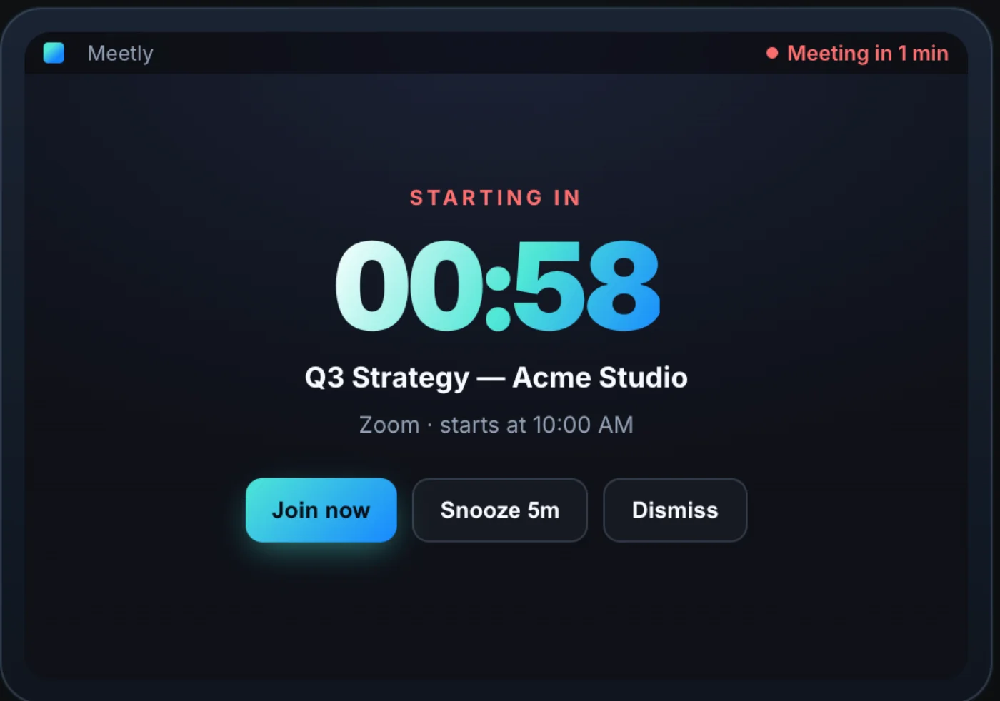

**Cyber Monday 2026 is 30 November** — and it is also the final day of the codeonholiday Black Friday sale. After that, every Pro app returns to list price. If you skipped the Black Friday rush, this is the last window: **50% off every Pro app** with code **BLACKFRIDAY**.

Searching for **Cyber Monday Mac app deals**, **Cyber Monday software deals 2026**, or a final chance at one-time licenses before everything goes subscription-only elsewhere? Three native Mac apps are in the sale: [Meetly](/meetly/), [HoverBoard](/hoverboard/), and [LocalMelody](/localmelody/).

**Short answer:** code **BLACKFRIDAY** applies to everything, and it is auto-filled when you click Buy Pro. The whole store — all three Pro licenses — is **$17.97 once** during the sale.

## Last-chance pricing

| App | Regular price | Cyber Monday price (50% off) |
|---|---:|---:|
| [Meetly](/meetly/#pricing) Pro Lifetime | $9.99 | **$4.99** |
| [HoverBoard](/hoverboard/#pricing) Pro Lifetime | $15.99 | **$7.99** |
| [LocalMelody](/localmelody/#pricing) Pro Lifetime | $9.99 | **$4.99** |

All three are **one-time lifetime licenses** — pay once, own them. No subscription renews next Cyber Monday. All apps require macOS 14 or later; the checkout page is the source of truth for the current price.

## What each app fixes

**Meetly — the meetings you keep missing.** A fullscreen reminder with Join, Snooze, Dismiss fires across your displays before every event, with one-click join for Zoom, Google Meet, and Teams. Pro adds the Quick Panel, unlimited calendars, action items, Apple Reminders, quiet hours, and iCloud sync. ([Deal details](/blog/meetly-black-friday-deal/))

**HoverBoard — the screen you keep sharing.** Draw over any app, spotlight the cursor, freeze a changing UI, open a whiteboard, and display keystrokes while teaching. Spotlight, Break Timer, Screenshot, and Screen Record stay free; Pro unlocks the full presenting toolkit. ([Deal details](/blog/hoverboard-black-friday-deal/))

**LocalMelody — the music you keep uploading elsewhere.** Generate AI music locally on Apple Silicon with lyrics in English, Tiếng Việt, Español, and 简体中文. Free covers 15-second songs; Pro unlocks up to 240 seconds, genre/mood/voice/BPM/key controls, voice reference, and export.

## Why buy one-time on Cyber Monday

Subscription app prices rise quietly every year; a lifetime license bought once never bills you again. At Cyber Monday pricing, all three Pro apps together cost **less than a single month of a typical subscription stack** — and you keep them permanently.

## How to claim it

1. Open an app's pricing section: [Meetly](/meetly/#pricing) · [HoverBoard](/hoverboard/#pricing) · [LocalMelody](/localmelody/#pricing).
2. Click **Buy Pro** — checkout opens with **BLACKFRIDAY** already applied.
3. Complete the purchase before the sale closes at the end of **30 November 2026**.

Missed the full Black Friday breakdown? It is still here: [Black Friday Mac App Deals 2026](/blog/black-friday-mac-app-deals-2026/).

## Cyber Monday FAQ

**When does the sale end?** At the end of 30 November 2026 (Cyber Monday). After that, list prices return.

**Is BLACKFRIDAY valid on Cyber Monday?** Yes — the same code and the same 50% off run straight through Cyber Monday.

**Are these subscriptions?** No. Every license is a one-time lifetime purchase.

**Can I still try free first?** Yes — every app keeps a real free tier after the sale. Download, test, and upgrade before the deadline if Pro fits.

**Can I buy for someone else?** A Pro license makes a cheap, practical gift for a Mac user — buy during the sale and share the license details with them.
