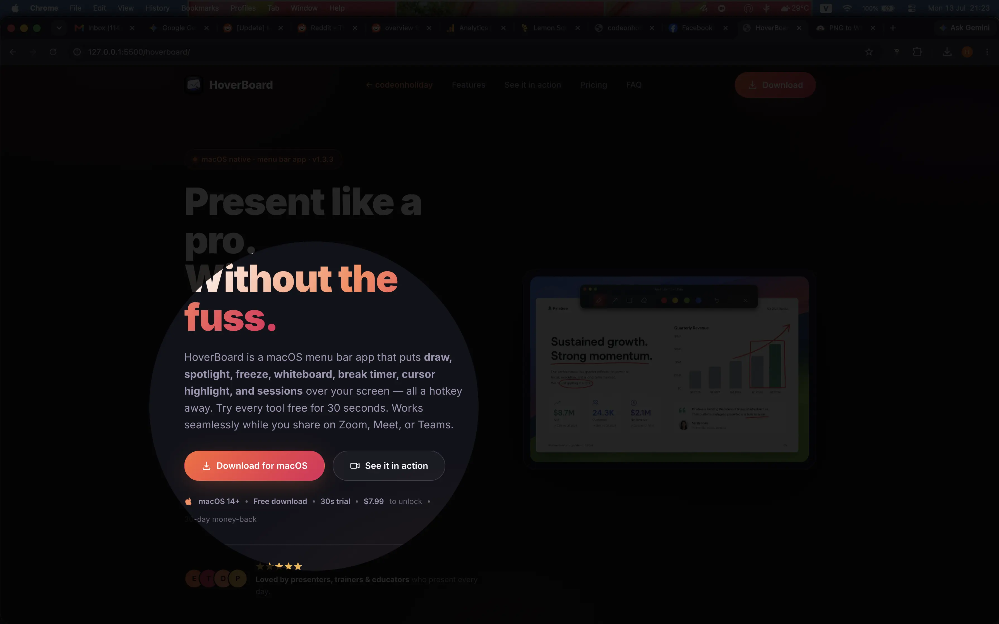

If you have been waiting for a **HoverBoard discount** to unlock Draw, Freeze, Whiteboard, and Keystroke Display, this is the one: for Black Friday 2026, **HoverBoard Pro Lifetime is 50% off** — **$7.99 once** instead of $15.99 — with code **BLACKFRIDAY** through **30 November 2026**.

That is a one-time payment, not a subscription. No monthly meter, no export watermark countdown, no renewal email next November.

## The deal

| | |
|---|---|
| Regular price | $15.99 one-time |
| Black Friday price | **$7.99 one-time** |
| Code | **BLACKFRIDAY** (auto-applied when you click Buy Pro) |
| Ends | 30 November 2026 |

[Get HoverBoard Pro at 50% off](/hoverboard/#pricing) — click **Buy Pro** and the checkout opens with the discount already filled in. Requires macOS 14 or later; the checkout page is the source of truth for the current price.

## What Pro unlocks

HoverBoard is the Mac tool for the moment you share your screen — teaching, demoing, onboarding, recording walkthroughs. The free tier keeps **Spotlight, Break Timer, Screenshot, and Screen Record free forever**. Pro Lifetime unlocks the full toolkit:

- **Draw** — annotate live over any app during screen share
- **Freeze** — pause a changing UI and explain the frame without racing it
- **Whiteboard** — sketch ideas mid-session without leaving the flow
- **Keystroke Display** — show shortcuts while you teach them
- **Cursor Halo & Spotlight** — make the pointer impossible to lose
- **Notes** — private presenter notes beside the session
- **Sessions & Recording** — structured capture of demos and classes

Every Pro tool includes a 60-second trial, so you can confirm the workflow fits before the sale ends.

## Why one-time beats subscription here

A CleanShot X or Screen Studio subscription costs more in two or three months than HoverBoard Pro costs **this week, forever**. They are polished tools for polished async video; HoverBoard is built for the *live* moment — drawing over Zoom shares, freezing a dashboard mid-demo, walking a class through an IDE with keystrokes on screen.

If you present or teach from a Mac regularly, $7.99 once is the cheapest upgrade to your sessions you will find this season. For the full comparison, read [HoverBoard vs CleanShot X](/blog/hoverboard-vs-cleanshot-x/), [HoverBoard vs Presentify](/blog/hoverboard-vs-presentify/), or the [best annotation tool for macOS](/blog/best-annotation-tool-macos/) roundup.

## How to get it

1. Go to the [HoverBoard pricing section](/hoverboard/#pricing).
2. Click **Buy Pro** — the code **BLACKFRIDAY** is applied automatically at checkout.
3. Finish checkout; your license activates in the app.

Prefer to test first? Download free and run the 60-second Pro trials — then decide before **30 November 2026**, when the price returns to $15.99.

## HoverBoard Black Friday FAQ

**Is the license a subscription?** No. Pro Lifetime is a one-time purchase. $7.99 once during the sale.

**Does the code apply automatically?** Yes — during the sale, clicking Buy Pro opens checkout with BLACKFRIDAY prefilled. You can also type it manually.

**What stays free after the sale?** Spotlight, Break Timer, Screenshot, and Screen Record — permanently.

**Where do I learn the full workflow?** Start with the [complete HoverBoard guide](/blog/how-to-use-hoverboard-complete-guide/), then the feature deep-dives on [Draw](/blog/how-to-use-hoverboard-draw/), [Freeze](/blog/how-to-use-hoverboard-freeze/), and [Whiteboard](/blog/how-to-use-hoverboard-whiteboard/).

Also shopping the rest of the store? Meetly and LocalMelody Pro are 50% off too — see the [Black Friday Mac app deals](/blog/black-friday-mac-app-deals-2026/) roundup.
