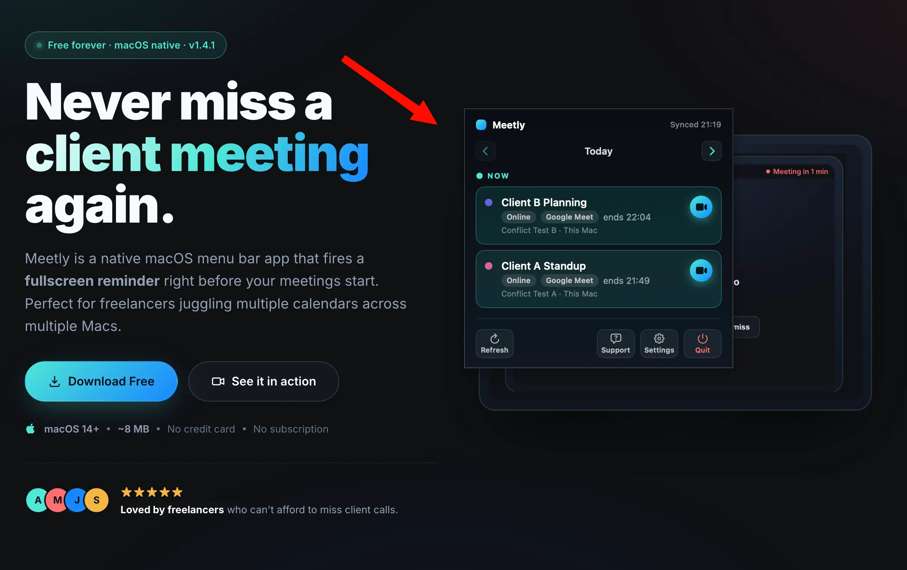

The cheapest productivity upgrade this Black Friday might also be the one you notice most: **Meetly Pro Lifetime is 50% off** for Black Friday 2026 — **$4.99 once** instead of $9.99 — with code **BLACKFRIDAY** through **30 November 2026**.

Meetly is the native macOS menu bar app for the minute before a meeting starts. Instead of a banner you tab away from, it fires a **fullscreen reminder** across your displays with Join, Snooze, and Dismiss — plus one-click join for Zoom, Google Meet, and Microsoft Teams.

## The deal

| | |
|---|---|
| Regular price | $9.99 one-time |
| Black Friday price | **$4.99 one-time** |
| Code | **BLACKFRIDAY** (auto-applied when you click Buy Pro) |
| Ends | 30 November 2026 |

[Get Meetly Pro at 50% off](/meetly/#pricing) — click **Buy Pro** and checkout opens with the discount already applied. Requires macOS 14 or later; the checkout page is the source of truth for the current price.

## What Pro unlocks

The free tier covers the core workflow forever: fullscreen reminders and one-click join on one calendar. Pro Lifetime adds the pieces that matter once meetings run your week:

- **Quick Panel** — a pinnable panel with your next meetings, always one glance away
- **Unlimited calendars** — combine work, personal, and shared team calendars
- **Free-time sharing** — send booking-safe availability without exposing your schedule
- **Action items** — capture decisions right after the meeting ends
- **Apple Reminders with due dates** — turn meeting outcomes into tracked tasks
- **Quiet hours** — no fullscreen interrupts during off-hours
- **Screen-share privacy** — reminders stay discreet while you present
- **iCloud sync** — settings across all your Macs

## Why $4.99 once is hard to beat

Most calendar and reminder tools moved to subscriptions years ago — $3 to $10 *per month*, forever. Meetly Pro at Black Friday pricing costs less than **one month** of those, and it is yours permanently: pay once, own the license, no renewal.

If you have missed a standup, a client call, or a class because a corner notification lost the fight for your attention, a fullscreen interrupt fixes exactly that. For a wider comparison, read [Best Meeting Reminder App for macOS](/blog/best-meeting-reminder-app-macos/), [Meetly vs MeetingBar](/blog/meetly-vs-meetingbar/), or [Meetly vs In Your Face](/blog/meetly-vs-in-your-face/).

## How to get it

1. Go to the [Meetly pricing section](/meetly/#pricing).
2. Click **Buy Pro** — the code **BLACKFRIDAY** is filled in automatically at checkout.
3. Activate the license in the app; reminders keep firing from the menu bar.

Not sure yet? Run the free tier through your actual week first — then upgrade before **30 November 2026**, when the price returns to $9.99.

## Meetly Black Friday FAQ

**Is Meetly Pro a subscription?** No. Pro Lifetime is a one-time purchase — $4.99 once during the sale.

**Do I need to grant calendar access?** Meetly reads the calendars already visible in macOS Calendar: Google, Outlook, iCloud, Exchange, and more. Nothing to re-connect.

**Does the code apply automatically?** Yes — clicking Buy Pro during the sale opens checkout with BLACKFRIDAY prefilled.

**What stays free after the sale?** The core reminder workflow on one calendar, permanently.

**Where do I learn the full setup?** Start with the [How to Use Meetly complete guide](/blog/how-to-use-meetly-complete-guide/), then the [Quick Panel](/blog/how-to-use-meetly-quick-panel/) and [Apple Reminders](/blog/how-to-use-meetly-apple-reminders/) deep-dives.

HoverBoard and LocalMelody Pro are also 50% off this week — the full list is in the [Black Friday Mac app deals](/blog/black-friday-mac-app-deals-2026/) roundup.
